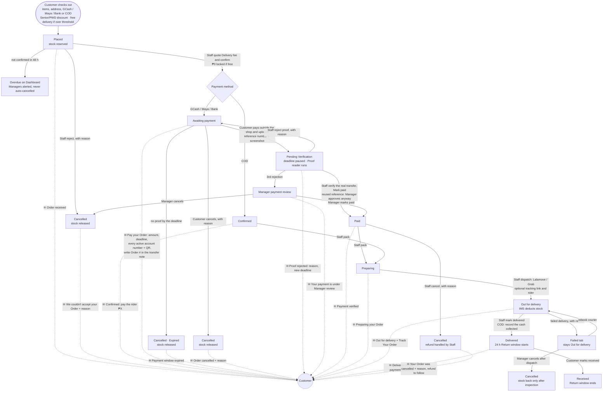

# Order lifecycle: Orders, Payments and Fulfilment

The business process from checkout to delivery, with every Status email the Customer gets. The words are defined in
`CONTEXT.md` (Order status, Delivery fee, Payment proof, Payment account, Free delivery threshold, Reservation,
Fulfilment board, Courier details, Failed delivery, COD collection, Status email); this page only puts them in order.
Returns, refunds and Tickets start after delivery and are not covered here.

- The storefront owns the Order and sends every email. CREOMS asks the storefront to make each change and never
  sends an email itself; a failed email never undoes the change, CREOMS shows "Email not sent" and Staff can Resend.
- There is no payment gateway. The Customer pays outside the shop (GCash, Maya or bank transfer) and Staff check
  the proof by hand. CREOMS never takes money.
- Payment accounts (number and QR), the Free delivery threshold, the payment window and the Approval limit are
  Commerce Settings under Management (Manager and CEO), never values in code.

## Flow

## Who does what

| Step | Customer | Staff | Manager | CEO |
|---|---|---|---|---|
| Place the Order | yes | never (except a Replacement Order) | | |
| Confirm with a Delivery fee, or reject with a reason | | yes | yes | view |
| Cancel | until paid | up to Preparing | after dispatch, with a plan for courier, money and stock | view |
| Upload payment proof | yes | | | |
| Mark paid / Reject proof | | yes | yes | view |
| Reused reference, 3rd rejection | | Request approval | approves | view |
| Pack, dispatch, failed delivery, mark delivered | | yes | yes | view |
| Mark received | yes | | | |
| Payment accounts, threshold, payment window | | | yes | yes |

## Money

- Total = subtotal − Senior/PWD discount + Delivery fee.
- Free delivery is judged on the subtotal after discounts, saved on the Order at placement, and never changed by a
  later threshold change. Below the threshold Staff quote the fee by hand (₱0 is allowed).
- Money and Manager decisions are never optimistic: confirming with a fee, Mark paid, approve anyway and a
  cancellation after dispatch wait for the server with a spinner.

## Emails

| Event | Email | Kind recorded |
|---|---|---|
| Staff confirm, online payment | Pay your Order: amount, deadline, every active Payment account with its number and QR (inline image), write the Order number in the transfer note, Pay order / Cancel order | `online-delivery-confirmed` |
| Staff confirm, COD | Confirmed: pay the rider in cash | `delivery-confirmed` |
| Staff reject or cancel | We couldn't accept your Order (or Your Order was cancelled), the reason, not charged or refund to follow | `cancelled-by-shop` |
| Proof verified / rejected / 3rd rejection | Payment verified / Proof rejected with reason and new deadline / Manager review started | `payment-verified`, `payment-rejected`, `manager-review-started` |
| Payment window expired | Your Order was cancelled because the payment window expired | `payment-expired` |
| Preparing, dispatched, delivered | Preparing / Out for delivery / Delivered | `preparing`, `dispatched`, `completed` |

The Pay your Order email reads the active accounts when it is sent, so a retry or Resend shows the accounts as they
are then. QR codes travel inside the email, because their signed links expire. With no active account the email
shows the "contact the shop" notice; it never switches the Order to Cash on Delivery.
